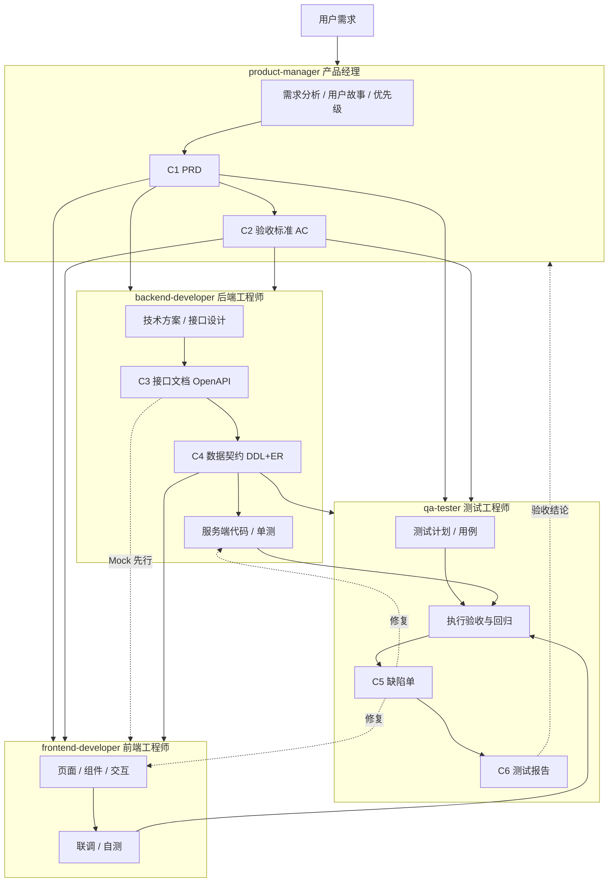

# multi-agents

多角色 AI 协作 Skill 仓库：把**产品经理、前端工程师、后端工程师、测试工程师**四个研发角色封装成独立的 Skill（角色能力包），通过标准化的 **契约体系（C1–C6）** 在角色间传递产物，使多个 Agent 实例可以像真实团队一样接力完成「需求 → 设计 → 开发 → 测试 → 交付」全流程。

## 整体架构



核心思想：**角色能力（Skill）与协作契约（Contract）分离**。Skill 定义「怎么做」，契约定义「交接什么」——契约格式固定、变更升版、模板统一，是下游角色唯一的开工依据（契约先行）。

## 目录结构

```
multi-agents/
├── PLAN.md                        # 完整开发计划（角色设计 / 契约体系 / 实施步骤）
├── README.md
├── DESIGN.md                      # 跨端设计实现参考规范（参考模板；业务项目以项目根目录 DESIGN.md 为规范）
├── LICENSE
├── .agents/
│   └── skills/                    # 四个角色 Skill（.agents 开放标准目录，跨 Agent 产品通用）
│       ├── product-manager/       #   产品经理
│       ├── frontend-developer/    #   前端工程师
│       ├── backend-developer/     #   后端工程师
│       └── qa-tester/             #   测试工程师
├── .workbuddy/
│   ├── skills -> ../.agents/skills  # 软链接入，WorkBuddy 自动发现（唯一真实副本在 .agents/skills/）
│   └── memory/                    # 项目记忆（工作日志，不入库）
├── docs/                          # 契约产物区（按契约类型分目录）
│   ├── prd/                       #   C1 PRD
│   ├── api/                       #   C3 接口文档（OpenAPI）
│   ├── db/                        #   C4 数据契约（DDL + ER）
│   └── test/                      #   测试计划 / 用例 / C6 测试报告
├── issues/                        # C5 缺陷单
└── dist/                          # Skill 打包产物（zip，不入库）
```

每个 Skill 采用标准三层结构，遵循渐进式加载，控制上下文膨胀：

```
<skill>/
├── SKILL.md            # 角色定位 / 触发词 / 工作流 / 契约清单（精简，必载）
├── references/         # 模板与规范（按需加载，不占基础上下文）
│   ├── 契约模板 ...
│   └── 技术栈规范 ...
├── assets/             # 脚手架 / 骨架文件（需要时复制使用）
└── scripts/            # 校验与生成脚本（确定性执行）
```

## 四个角色 Skill

| Skill | 角色 | 触发场景（示例） | 消费 | 产出 |
|---|---|---|---|---|
| `product-manager` | 产品经理 | 写 PRD、需求拆解、用户故事、优先级排序、竞品分析、定验收标准 | 用户需求、竞品资料 | **C1 PRD**、**C2 验收标准**、Backlog |
| `frontend-developer` | 前端工程师 | 开发页面、实现 UI/交互、写组件、响应式适配、前端自测 | C1、C3、C4 | 页面/组件代码、前端自测记录、联调问题清单 |
| `backend-developer` | 后端工程师 | 设计接口、写 OpenAPI 文档、设计表结构/ER、开发服务端代码 | C1 | 技术方案、**C3 接口文档**、**C4 数据契约**、服务端代码、单测 |
| `qa-tester` | 测试工程师 | 写测试计划、设计用例、提缺陷单、执行验收/回归、出测试报告 | C1、C2、C3、C4、实现代码 | 测试计划、测试用例、**C5 缺陷单**、**C6 测试报告** |

**技术栈定位**

- 前端：React / Vue / Flutter / Electron / 微信小程序（SKILL.md 内置选型决策树，分栈详细规范放在 `references/` 按栈加载）；
- 后端：Java + Spring Boot / Python（FastAPI / Django）（同样决策树 + 双栈规范）；
- 契约格式语言无关：C3 统一 OpenAPI 3.x，C4 统一 DDL + ER，跨栈通用。

## 契约体系（C1–C6）

| 契约 | 内容 | 生产者 | 消费者 |
|---|---|---|---|
| C1 | PRD（做什么/为什么，不含怎么做） | 产品 | 前端、后端、测试 |
| C2 | 验收标准（Given/When/Then，可测试） | 产品 | 前端、后端、测试 |
| C3 | 接口文档（OpenAPI 3.x，唯一事实源） | 后端 | 前端、测试 |
| C4 | 数据契约（ER + DDL + 字段说明） | 后端 | 前端、测试 |
| C5 | 缺陷单（复现步骤/期望/实际/优先级） | 测试 | 前端、后端 |
| C6 | 测试报告（用例执行汇总/AC 覆盖/放行结论） | 测试 | 前端、后端、产品 |

三条契约纪律：

1. **契约先行**：下游角色没有契约不开工；前端可以基于 C3 mock 并行开发，但 mock 必须与 C3 一致；
2. **变更升版**：契约变更必须升版本号（如 `todo-api-v1.0` → `v1.1`）并通知所有消费方，禁止静默修改；
3. **模板统一**：六套契约模板存于生产者 Skill 的 `references/`，四角色共用同一套格式。

## 使用方式

四个 Skill 位于 `.agents/skills/`（`.agents` 开放标准目录，Codex、Cursor 等产品原生读取；WorkBuddy 经 `.workbuddy/skills` 软链自动发现）。在 WorkBuddy 对话中**提及对应场景即自动触发**，无需手动加载：

- 「帮我写一个 XX 需求的 PRD」→ 触发 `product-manager`
- 「用 React 实现 XX 页面」→ 触发 `frontend-developer`
- 「设计 XX 模块的接口和表结构」→ 触发 `backend-developer`
- 「给 XX 功能写测试用例 / 出测试报告」→ 触发 `qa-tester`

**典型协作循环**（单次迭代）：

1. 产品：需求 → 输出 C1 + C2（小需求可只写用户故事 + AC，走轻量通道）；
2. 后端：基于 C1 设计并输出 C3 + C4；
3. 前端：消费 C1 + C3（mock 先行）→ 实现 → 联调；
4. 测试：消费 C1 + C2 + C3 + C4 → 用例 → 执行 → C5 / C6；
5. 缺陷修复（前后端消费 C5）→ 回归 → C6 放行。

契约产物统一落在 `docs/` 与 `issues/`，命名规范：`<日期/模块>-<名称>-<版本号>.<格式>`。

## 工具脚本

| 脚本 | 所属 Skill | 用途 |
|---|---|---|
| `scripts/validate_openapi.py` | backend-developer | 校验 C3 接口文档的 OpenAPI 结构完整性（路径/引用/Schema 校验） |
| `scripts/gen_test_report.py` | qa-tester | 从用例执行 CSV 自动生成 C6 测试报告（含 AC 覆盖矩阵） |
| `scripts/scaffold.sh` | frontend-developer | 前端项目脚手架（复制对应栈的 starters 骨架） |

```bash
# 校验 C3
python3 .agents/skills/backend-developer/scripts/validate_openapi.py docs/api/<api>.yaml

# 由 CSV 生成 C6 测试报告
python3 .agents/skills/qa-tester/scripts/gen_test_report.py docs/test/<results>.csv -o docs/test/<report>.md
```

## 联调试跑示例

`docs/` 与 `issues/` 中存放了以「待办事项应用（Todo App）」为需求的全流程联调产物，验证四角色 + 六契约闭环：

- C1：`docs/prd/2026-10-17-todo-app-v1.0.md`（8 条 AC）
- C3：`docs/api/todo-api-v1.0.yaml`（通过 `validate_openapi.py` 校验）
- C4：`docs/db/todo-db-v1.0.md`（ER + MySQL DDL）
- 测试：`docs/test/`（15 条用例，AC 覆盖率 100%）
- C6：`docs/test/todo-test-report-v1.0.md`（通过率 93.3%，由脚本生成）
- C5：`issues/BUG-001.md`（缺陷单示例：空标题创建返回 500）

## 敏捷迭代适配

Skill 是**角色能力包而非阶段流程**，天然适配逐步迭代：把使用单位从「一个项目走一遍全流程」改为「每个 Sprint 走一遍小循环」——迭代启动时产出轻量契约（C1 只写用户故事 + AC，C3/C4 只做增量）→ 前后端并行 → 测试验收 → 回归用例沉淀 → 下一迭代，契约版本号随迭代递增。

## 协作流程

```bash
git clone git@github.com:ThinkMars/multi-agents.git
cd multi-agents
# 本地提交后推送；远程有新内容时用 git pull --rebase 整合
```

Skill 的任何修改都通过 PR / commit 评审后合并，保证四角色收到的契约模板与规范始终一致。
